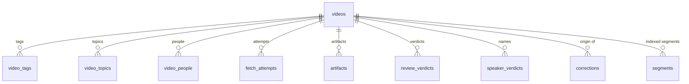
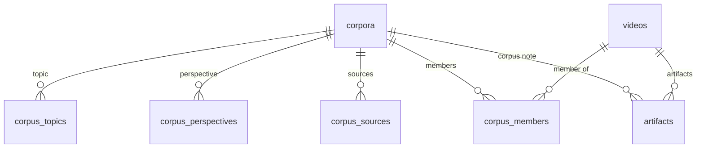

# Storage schema

Status: DRAFT — not yet ratified by the owner. Written in ytlm on 2026-10-03
(nagarkar/ytlm#23) and moved here with the schema on 2026-10-03
(nagarkar/ytlm#50). Names like `pipeline-and-surfaces.md`, "(was D10)" and
the `#23` issue numbers refer to ytlm's docs and tracker.

Scope: the tables, views and history rules of the shared transcript
database, and how an older database is upgraded. Today the file is
ytlm's `<workspace>/ytlm.sqlite`; it moves to
`/Volumes/Crucial X6/corpuslm/transcript.sqlite` in a later step of
nagarkar/ytlm#50. The JSON state files beside it stay in each consumer's
docs (ytlm: `docs/design/storage-schema.md`). The storage decision itself
(hybrid SQLite catalog + FTS5 + artifact files, the KnowledgeObject base)
is in ytlm's `docs/design/pipeline-and-surfaces.md` and is unchanged.
This document mirrors the code: the schema is defined in
[`src/corpuslm/db.py`](../../src/corpuslm/db.py#L60) (`TABLES`, `TRIGGERS`, `VIEWS`)
and `tests/test_db.py::test_the_schema_document_mirrors_the_code` fails
when the two differ. Change the code first, this document with it.

What hangs off a video:

What hangs off a corpus, and where the two meet:

## One module owns the store (2026-10-03)

[`src/corpuslm/store.py`](../../src/corpuslm/store.py#L43) is the Repository: every
read and write of the database goes through a named method of `Store`
(`video`, `record_artifact`, `append_review_verdict`, `search` ...).
`db.py` holds the connection, the schema and the migrations. No other
module, here or in a consumer, writes SQL against this database;
`tests/test_db.py` fails when one in corpuslm does, and each consumer
keeps the same test over its own source. In ytlm, `document.py` reads
corpora and members and writes a corpus's `metadata` through
`Store.corpus_by_name`, `Store.ingested_member_rows` and
`Store.set_corpus_metadata` (2026-10-03); its one module allowed by name
is `adapters/_authorlm_real.py`, which speaks to authorlm's database
through authorlm's own handle, never to this one.

**Why:** architecture.md, "OOAD patterns": one module owns reads and
writes of a store, so the rules below (append-only decisions, derived
status, list tables) hold in one place.
**Rules out:** SQL in api.py, runner.py, review.py, reviewpage.py or
digest.py; a second module that knows the table layout.

## Integrity lives in the database (2026-10-03)

Every table is `STRICT`. Every enumerated column has a `CHECK` listing its
values; every reference has a `FOREIGN KEY` (`PRAGMA foreign_keys = ON` on
every connection); JSON columns carry `CHECK (json_valid(...))`. A stored
JSON value that does not parse raises `CorruptValue` naming it
(`db.loads`); it is never read as an empty default.

**Why:** architecture.md, "Relational design" and coding.md, "Failure": a
typo or a bad write stops where it is made, not discovered later.
**Rules out:** enums kept only in comments; reading a corrupt column as
"no topics".

## Lists are rows, not JSON (2026-10-03)

A video's tags, topics and people and a corpus's topic, perspective and
sources were JSON lists in one column; each is now a table with one row
per element and its `position` (third normal form). The Repository reads
them back as Python lists under the old names, so callers see
`video["tags"]` as before. JSON objects that are read and written whole
and never joined on stay JSON documents: `metadata`, `artifacts.inputs`,
`artifacts.provenance`.

**Why:** architecture.md, "Relational design": normalize to 3NF; no query
profile was measured that would justify keeping the lists denormalized.
**Rules out:** new JSON-list columns.

## Explicit names; JSON artifacts keep theirs (2026-10-03)

The segment columns are `position`, `start_seconds` and `end_seconds`
(they were `idx`, `t0`, `t1`). Only the database columns changed:
`transcript.json`, the digest and every other JSON artifact keep `idx`,
`t0` and `t1`, which their schemas under ytlm's `src/ytlm/schemas/` define, and
`Store.replace_segments` maps one to the other.

**Why:** architecture.md, "Relational design": explicit names, no
abbreviations.
**Rules out:** renaming fields in JSON artifacts already on disk (that
would invalidate every artifact hash).

## Each fact once: membership status is derived (2026-10-03)

`corpus_members` no longer stores a status. The view `vw_corpus_members`
derives it from the video: `added` → `queued`, `ingested` → `ingested`,
anything else → `failed`. The video's `status` and `last_error` are the one
record of what happened.

**Why:** architecture.md, "Surfaces and stores": state never lives in two
places. The stored copy could disagree (a metadata failure left members
`queued` while the video was `failed`).
**Rules out:** writing a status on membership rows.

## One history pattern per kind of table (2026-10-03)

| Kind | Tables | Rule |
|---|---|---|
| master data | `videos`, `corpora`, `corpus_members` and the list tables | mutable; `version` bumps on every update; a trigger writes every changed column to `change_log` (old value, new value, row version); list tables are written position by position and log each element added or removed (an element that moves counts as removed and added) |
| decisions | `review_verdicts`, `speaker_verdicts`, `corrections` | append-only (a trigger aborts UPDATE and DELETE); an answer given again or changed is a new row; the newest row per slot is in force (`vw_current_*`) |
| evidence | `fetch_attempts`, `change_log` | append-only |
| runs | `runs` | one row per pipeline run (`ytlm run`), opened `running` and closed once as `ok` or `error` |
| derived state | `artifacts`, `segments`, `segments_fts` | rebuilt from files; no history |
| coordination | `locks` | deleted when released; no history |

A verdict that lands again unchanged (a re-run `review apply`) adds no
row. The correction memory reclassified by a newer rule
(`review.rekind_corrections`) writes the new kind forward as a new row.

**Why:** architecture.md, "History and identity": decisions are
append-only, undo writes forward, master data keeps a field-level change
log by trigger.
**Rules out:** `UPDATE` of a verdict, a speaker name or a memory rule.

## A verdict carries the content hash of what it judged (2026-10-03)

`review_verdicts.subject_sha256` is the SHA-256 of canonical JSON (keys
sorted, no whitespace, UTF-8, `db.canonical_sha256`) of what was judged,
with the type included and the review key left out
(`review.subject_sha256`): an ambiguity is
`{"type": "ambiguity", "video_id", "span": <normalized span>}`, a speaker
question `{"type": "speaker", "video_id", "role"}`. When a new verdict for
the same key judged different content, `previous_subject_sha256` holds the
old hash (lineage: new hash → old hash).

The verdict in force is still found by its key and re-placed by key and
span, as [review.md](review.md) and
[transcript-cleanup.md](transcript-cleanup.md) ("Verdicts already
applied") decide. Keying the lookup on the hash instead is an owner's
call. Keep key + span (Ruled 2026-10-03) (owner: "Keep key + span"); the hash is stored for lineage only. This is a documented exception to metalm architecture.md#history-and-identity ("approvals key on it"), listed in [README.md](README.md#grandfathered-exceptions).

**Why:** architecture.md, "History and identity": approvals key on a
content hash so a cosmetic change never reopens a question, and edits
keep lineage.
**Rules out:** recomputing a stored hash when a key is renumbered.

## Migrations: user_version, a verified backup, one transaction (2026-10-03)

The schema version is `PRAGMA user_version` (`db.USER_VERSION`, now 2; a
database made before it was tracked reads 0 and has the v1 schema, frozen
in `tests/fixtures/schema_v1.sql`). On open, `db.migrate`:

1. declines a database whose version is newer than this code
   (`NewerDatabase`; nothing is touched);
2. gives a new, empty file the whole schema in one transaction;
3. upgrades an older database in place: first a backup through SQLite's
   backup API to `<db folder>/backups/<db file stem>-<UTC timestamp>-before-v2.sqlite`
   (`db.BACKUPS_DIRNAME`, in `src/corpuslm/db.py`), verified with
   `PRAGMA integrity_check` and a row count of every author table
   (`review_verdicts`, `speaker_verdicts`, `corrections`); then the rebuild
   in one `BEGIN IMMEDIATE … COMMIT` with `PRAGMA foreign_key_check`
   before the commit and `user_version` set inside it; then
   `PRAGMA integrity_check` and the author-table counts again. Any failure
   rolls back and names the backup (`MigrationFailed`).

The v1 → v2 rebuild renames each v1 table to `legacy_v1_<name>`, creates
the v2 tables, copies every row, drops the legacy tables, rebuilds the FTS
index, then creates triggers and views (so the copy writes no change-log
rows). A v1 `perspective` of `''` becomes NULL: it was the column default,
so it meant "not known yet". A v1 database made before the detail columns
existed gains them first.

Retention (Ruled 2026-10-03, "keep the newest three"): after a new backup
passes `PRAGMA integrity_check` and the row counts, `db.prune_backups`
deletes all but the three newest files in `<workspace>/backups/` that
match the backup name pattern (`<db file stem>-<YYYYMMDDTHHMMSSZ>-<label>[-<n>].sqlite`;
`db.BACKUPS_KEPT = 3` in `src/corpuslm/db.py`); any other file there is left
alone. The board of the verb that opened the database says, under
`migration`, which backups were deleted (`backups_deleted`).

Proof on a copy of the real workspace database (2026-10-03, 175 videos):
every table kept its row count; the 559 review verdicts, 21 speaker
verdicts, 552 corrections and 173,764 segments hashed the same before and
after; every video's tags, topics and people read back equal; the derived
membership status equalled the stored one for all 173 members.

**Why:** coding.md, "Storage and migrations" (user_version, one explicit
transaction, nullable without default where NULL is the honest history)
and operations.md (no irreplaceable database without a verified backup).
**Rules out:** `ALTER TABLE` outside a tracked migration; a migration with
no backup.

## Tables

Every table but `locks`, `segments` and `segments_fts` starts with the
knowledge-object base, written `(base)` below: `id TEXT` primary key,
`version INTEGER` (from 1), `created_at TEXT` (ISO UTC), `created_by TEXT`
(the client: cli, runner, digest, podlm, authorlm, migration, trigger),
`schema_version TEXT` (the row's schema, now `2`), `metadata TEXT` (a JSON
object). Null is "no" unless marked.

### `videos`

History: master.

| column | type | null | meaning |
|---|---|---|---|
| (base) | | | |
| url | TEXT | no | the watch URL |
| title | TEXT | no | from the metadata provider |
| channel_id | TEXT | no | |
| channel_title | TEXT | no | |
| published_at | TEXT | no | ISO date, or `UNKNOWN` |
| duration_seconds | INTEGER | yes | NULL when unknown |
| description | TEXT | no | |
| thumbnail_url | TEXT | no | |
| language | TEXT | no | Data API defaultAudioLanguage |
| caption_language | TEXT | no | the track actually fetched |
| caption_kind | TEXT | no | one of ``, `manual`, `generated`, `none`, `unknown` |
| metadata_source | TEXT | no | one of ``, `dataapi`, `oembed` |
| has_caption_track | INTEGER | yes | 0 or 1; NULL when no provider said |
| status | TEXT | no | one of `added`, `ingested`, `no_captions`, `unavailable`, `failed` |
| fetcher | TEXT | no | the caption fetcher that produced the transcript |
| transcript_state | TEXT | no | one of ``, `RAW`, `DETERMINISTIC-ONLY`, `LLM-CLEANED` |
| last_error | TEXT | no | the last failure, `''` after a success |
| perspective | TEXT | yes | the video's perspective; NULL until the digest or the author sets it |

### `video_tags`

History: list `tags` of `videos`.

| column | type | null | meaning |
|---|---|---|---|
| (base) | | | |
| video_id | TEXT | no | the video |
| position | INTEGER | no | order in the list, from 0 |
| tag | TEXT | no | one Data API tag |

### `video_topics`

History: list `topics` of `videos`.

| column | type | null | meaning |
|---|---|---|---|
| (base) | | | |
| video_id | TEXT | no | the video |
| position | INTEGER | no | order in the list, from 0 |
| topic | TEXT | no | one topic (the digest's, or the author's) |

### `video_people`

History: list `people` of `videos`.

| column | type | null | meaning |
|---|---|---|---|
| (base) | | | |
| video_id | TEXT | no | the video |
| position | INTEGER | no | order in the list, from 0 |
| name | TEXT | no | a person in the video |
| role | TEXT | no | host, guest ... (`''` when none) |

### `corpora`

History: master.

| column | type | null | meaning |
|---|---|---|---|
| (base) | | | |
| name | TEXT | no | unique; matched without regard to case |
| person | TEXT | no | |
| subject | TEXT | no | |
| auto_ingest | INTEGER | no | 0 or 1 |
| llm_cleanup | INTEGER | no | 0 or 1; the per-corpus off switch for pass 3 |

### `corpus_topics`

History: list `topic` of `corpora`.

| column | type | null | meaning |
|---|---|---|---|
| (base) | | | |
| corpus_id | TEXT | no | the corpus |
| position | INTEGER | no | order in the list, from 0 |
| topic | TEXT | no | one topic |

### `corpus_perspectives`

History: list `perspective` of `corpora`.

| column | type | null | meaning |
|---|---|---|---|
| (base) | | | |
| corpus_id | TEXT | no | the corpus |
| position | INTEGER | no | order in the list, from 0 |
| perspective | TEXT | no | one perspective |

### `corpus_sources`

History: list `sources` of `corpora`.

| column | type | null | meaning |
|---|---|---|---|
| (base) | | | |
| corpus_id | TEXT | no | the corpus |
| position | INTEGER | no | order in the list, from 0 |
| source_id | TEXT | no | a playlist or channel id the corpus was filled from |

### `corpus_members`

History: master.

| column | type | null | meaning |
|---|---|---|---|
| (base) | | | |
| corpus_id | TEXT | no | the corpus |
| video_id | TEXT | no | the video; unique with corpus_id |
| reason | TEXT | no | one of `author`, `discovered`, `consumer` |

A merge (`Store.merge_corpora`) moves a membership by changing its `corpus_id` and
setting `metadata.merged_from` to the folded corpus's id, so the change log records the
move. The folded corpus's row, lists and members, whole, are appended to the target
corpus's `metadata.merged_from` before the folded rows are deleted: nothing a corpus
held is lost with its row.

### `fetch_attempts`

History: append-only.

| column | type | null | meaning |
|---|---|---|---|
| (base) | | | |
| video_id | TEXT | no | the video |
| fetcher | TEXT | no | the fetcher or `metadata:<provider>` |
| outcome | TEXT | no | one of `ok`, `skipped`, `none`, `error` |
| detail | TEXT | no | the reason, at most 500 characters |

### `artifacts`

History: derived.

| column | type | null | meaning |
|---|---|---|---|
| (base) | | | |
| video_id | TEXT | yes | the owning video; exactly one of video_id and corpus_id is set |
| corpus_id | TEXT | yes | the owning corpus (its note) |
| owner | TEXT | yes | generated: video_id or corpus_id, never stored |
| node | TEXT | no | the graph node; unique per owner |
| path | TEXT | no | relative to the workspace root, `''` when the artifact is in the database |
| sha256 | TEXT | no | hash of the artifact's bytes |
| state | TEXT | no | one of `built`, `stale`, `failed`, `skipped` |
| inputs | TEXT | no | JSON object: upstream node → sha256 |
| provenance | TEXT | no | JSON object: how it was built |

### `review_verdicts`

History: append-only.

| column | type | null | meaning |
|---|---|---|---|
| (base) | | | |
| video_id | TEXT | no | the video |
| key | TEXT | no | the review key (`amb-NNNN`, `spk-N`, `spk:ROLE`); names the slot |
| kind | TEXT | no | one of `ambiguity`, `speaker` |
| verdict | TEXT | no | the reading, the name, or `skip` |
| span | TEXT | no | the ambiguous span, for re-anchoring |
| role | TEXT | no | for speaker verdicts |
| source | TEXT | no | one of `review file`, `phone page` |
| applied_at | TEXT | no | when the author's answer landed |
| subject_sha256 | TEXT | no | content hash of what was judged (64 hex) |
| previous_subject_sha256 | TEXT | yes | the slot's previous hash when it differs (lineage) |

### `speaker_verdicts`

History: append-only.

| column | type | null | meaning |
|---|---|---|---|
| (base) | | | |
| video_id | TEXT | no | the video |
| role | TEXT | no | the speaker role |
| name | TEXT | no | the author's name for it |

### `corrections`

History: append-only.

| column | type | null | meaning |
|---|---|---|---|
| (base) | | | |
| span_norm | TEXT | no | the correction memory key: the span lowercased, punctuation stripped |
| verdict | TEXT | no | the author's reading |
| kind | TEXT | no | one of `term`, `reading` |
| origin_video | TEXT | no | the video the verdict was given on |
| origin_key | TEXT | no | its review key |

### `runs`

History: runs.

| column | type | null | meaning |
|---|---|---|---|
| (base) | | | |
| scope | TEXT | no | `workspace`, `corpus:<id>` or `videos:<n>` |
| status | TEXT | no | one of `running`, `ok`, `error`; `error` when any item failed or the run itself stopped |
| started_at | TEXT | no | |
| finished_at | TEXT | yes | NULL exactly while `running` |
| videos | INTEGER | yes | videos in scope |
| failed_items | INTEGER | yes | videos with an error |
| detail | TEXT | no | why the run itself stopped, else `''` |

### `change_log`

History: append-only.

| column | type | null | meaning |
|---|---|---|---|
| (base) | | | |
| table_name | TEXT | no | the master or list table |
| row_id | TEXT | no | the master row's id (for a list, its parent's) |
| column_name | TEXT | no | the column, or the list's name |
| old_value | ANY | yes | NULL for a list element added |
| new_value | ANY | yes | NULL for a list element removed |
| row_version | INTEGER | yes | the master row's version after the change; NULL for lists |

### `locks`

History: coordination.

| column | type | null | meaning |
|---|---|---|---|
| owner | TEXT | no | the video or corpus id being built |
| holder | TEXT | no | `host:pid` of the runner |
| acquired_at | TEXT | no | |
| expires_at | TEXT | no | |

### `segments`

History: derived.

| column | type | null | meaning |
|---|---|---|---|
| rowid | INTEGER | no | the FTS5 content rowid |
| video_id | TEXT | no | the video |
| position | INTEGER | no | the segment's `idx` in transcript.json |
| start_seconds | REAL | no | its `t0` |
| end_seconds | REAL | no | its `t1`, never before start_seconds |
| speaker | TEXT | no | |
| text | TEXT | no | |

`segments_fts` is the FTS5 index over `segments.text` (external content,
`unicode61`), kept in step by the triggers `segments_ai`, `segments_ad`,
`segments_au`.

## Views

### `vw_corpus_members` (view)

| column | type | null | meaning |
|---|---|---|---|
| id | TEXT | | the membership row |
| corpus_id | TEXT | | |
| video_id | TEXT | | |
| reason | TEXT | | |
| created_at | TEXT | | |
| member_status | | | `queued`, `ingested` or `failed`, from the video's status |

### `vw_search_segments` (view)

The search read path (FTS index → segment → video) flattened; search
joins `segments_fts` to it and filters a corpus with `EXISTS`.

| column | type | null | meaning |
|---|---|---|---|
| segment_rowid | INTEGER | | joins `segments_fts.rowid` |
| video_id | TEXT | | |
| position | INTEGER | | |
| start_seconds | REAL | | |
| end_seconds | REAL | | |
| speaker | TEXT | | |
| text | TEXT | | |
| title | TEXT | | the video's title |

### `vw_current_review_verdicts` (view)

Every column of `review_verdicts`; the newest row per (video_id, key).

### `vw_current_speaker_verdicts` (view)

Every column of `speaker_verdicts`; the newest row per (video_id, role).

### `vw_current_corrections` (view)

Every column of `corrections`; the newest row per span_norm.

## Example rows

Invented values, in the shape the code writes (`db.ko_fields`,
`Store.append_review_verdict`, the run rows of `Store`). The base columns
`version`, `schema_version` and `metadata` are left out; `metadata` is a
JSON object such as `{"user": "author"}`.

`videos` (one ingested video; `id` is the YouTube id):

| id | created_at | created_by | url | title | published_at | duration_seconds | status | fetcher | caption_kind | transcript_state | last_error |
|---|---|---|---|---|---|---|---|---|---|---|---|
| `Xq3vT9bLk2A` | `2026-09-21T03:30:12Z` | `cli` | `https://www.youtube.com/watch?v=Xq3vT9bLk2A` | `Talk 4: the three bodies` | `2024-11-02` | 2714 | `ingested` | `supadata` | `generated` | `LLM-CLEANED` | `` |
| `Pz0mR7cWq1E` | `2026-09-21T03:30:12Z` | `cli` | `https://www.youtube.com/watch?v=Pz0mR7cWq1E` | `Questions and answers` | `UNKNOWN` | NULL | `no_captions` | `` | `none` | `` | `` |

`review_verdicts` (the second row answers the same slot again after the
segment changed, so it carries the previous hash):

| id | created_by | video_id | key | kind | verdict | span | role | source | applied_at | subject_sha256 | previous_subject_sha256 |
|---|---|---|---|---|---|---|---|---|---|---|---|
| `ver-3f9a1c0d2b7e` | `cli` | `Xq3vT9bLk2A` | `amb-0007` | `ambiguity` | `Mitra` | `mithra` | `` | `phone page` | `2026-09-23T18:02:44Z` | `9c1e…` (64 hex) | NULL |
| `ver-a04d5e6f7788` | `cli` | `Xq3vT9bLk2A` | `amb-0007` | `ambiguity` | `Mitra` | `mithra` | `` | `review file` | `2026-09-30T08:15:03Z` | `4b72…` (64 hex) | `9c1e…` |
| `ver-11c2d3e4f5a6` | `cli` | `Xq3vT9bLk2A` | `spk:host` | `speaker` | `Swami A.` | `` | `host` | `review file` | `2026-09-23T18:05:10Z` | `e0d8…` (64 hex) | NULL |

`runs`:

| id | created_by | scope | status | started_at | finished_at | videos | failed_items | detail |
|---|---|---|---|---|---|---|---|---|
| `run-5b0e8a7c9d10` | `runner` | `workspace` | `ok` | `2026-09-30T03:30:00Z` | `2026-09-30T03:41:27Z` | 12 | 0 | `` |
| `run-c7d6e5f4a3b2` | `runner` | `corpus:cor-8e21f04b6a93` | `error` | `2026-10-01T03:30:00Z` | `2026-10-01T03:33:05Z` | 4 | 1 | `` |
| `run-0a1b2c3d4e5f` | `cli` | `videos:1` | `running` | `2026-10-02T09:12:40Z` | NULL | 1 | NULL | `` |

## Changes

- 2026-10-05: Corpora merge: `Store.merge_corpora` folds corpora into one in a transaction; each folded corpus is kept whole in the target's `metadata.merged_from` (nagarkar/ytlm#21)
- 2026-10-03: Written: the Repository, STRICT/CHECK/FOREIGN KEY, lists as rows, explicit segment column names, derived membership status, history per kind (change log by trigger, append-only decisions), verdict content hashes with lineage, the `runs` table, user_version migrations with a verified backup under `<workspace>/backups/`, and the state-file tables, metalm conformance (#23)
- 2026-10-03: Owner rulings: verdict lookup stays key + span (documented exception); backups keep the newest three, older ones deleted after a verified new backup (#23).
- 2026-10-03: Every whole-file write (state files, `tabs.json`, vault notes, `.env`, the manuscript files and `toc.toml` ytlm writes for authorlm, the Docs write record) goes through `paths.write_atomic`; the `tabs.json` gap is closed, metalm conformance (#23)
- 2026-10-03: Backup retention: the newest three verified backups are kept, older ones ytlm made are deleted after a new one verifies, and the board names them (owner ruling 2026-10-03; `db.BACKUPS_KEPT`), metalm conformance (#23)
- 2026-10-03: `document.py` reaches the database only through `Store`; its allowance in `tests/test_db.py` is removed, metalm conformance (#23)
- 2026-10-03: State-file tables for `<tab>.writer.json` (who wrote a corpus-document result) and the detached-job files under `<workspace>/jobs/`, metalm conformance (#23)
- 2026-10-03: The key + span ruling is dated in the "(Ruled YYYY-MM-DD)" form, metalm conformance (#23)
- 2026-10-03: Code links carry a line anchor; the entity diagram is split in two (video side, corpus side); example rows for `videos`, `review_verdicts` and `runs`, metalm conformance (#23)
- 2026-10-03: Moved from ytlm to corpuslm with `db.py`, `store.py`, `model.py` and `clock.py`; the canonical hash and the verdict subject hash move to `identity.py`; the SQL function `ytlm_subject_sha256` is renamed `corpuslm_subject_sha256` (registered per connection, never stored); the error for a newer database names corpuslm; the JSON state files stay in ytlm's copy of this document (nagarkar/ytlm#50)
