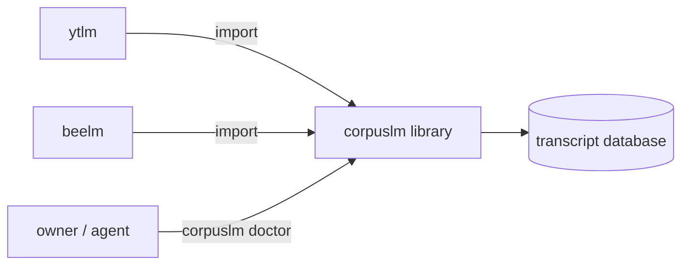

# Surfaces design

Status: DRAFT — not yet ratified by the owner.

Requirements: [../requirements/storage.md](../requirements/storage.md)

## A library first, with a small CLI (2026-10-03)

- corpuslm is a Python library; ytlm and beelm import it from an editable install of this repo (`pip install -e ../corpuslm`).
- The `corpuslm` command ([`src/corpuslm/cli.py`](../../src/corpuslm/cli.py)) has `help`, `completion`, `doctor PATH` (reads a database read-only and prints its schema version, journal mode, integrity check and table counts) and the review verbs below. `--json` anywhere prints the board as JSON. Nothing prints content.
- `setup` (creates the shared file, sets WAL) and the pointer check (each repo's `*_DB` resolves to the same file) come with the file-move step of nagarkar/ytlm#50.
- The repo skill is [`.claude/skills/corpuslm/SKILL.md`](../../.claude/skills/corpuslm/SKILL.md). No MCP server: no shell-less client needs corpuslm.

**Why:** metalm coding.md, "Surfaces": CLI always and first, a skill always, MCP only when needed. `doctor` is also the verification query the migration steps of #50 need (owner, 2026-10-03, grilling Q6).

**Rules out:** a library with no CLI recorded as an exception; an MCP server; a `doctor` that creates or upgrades a file.

## Review machinery is shared, with per-kind hooks (2026-10-08)

- `corpuslm.review` (verdicts, correction memory, the notes round trip), `corpuslm.review_page` (the phone page) and `corpuslm.vault` (marker rules, speaker properties, transcript lines, the corpus note) hold everything that does not depend on where a source came from. ytlm keeps shims at its old module paths; beelm will call them directly.
- What differs per source kind is one `corpuslm.review.ReviewKind`, passed in, never hard-wired: `anchor_url(source, seconds)` (a link to the moment, or None), `source_label(source)`, the `SpeakerScheme`, an optional footnote about the links, optional extra speaker names for the picker, and how a speaker label is spelled in a note's frontmatter key.
- A kind whose `anchor_url` returns None gets a time label with no link, in notes and on the page. Bee does: a `file://` link fails on a phone.
- The module only builds pages and notes. Serving a kind's recordings on a phone page over Tailscale needs the owner's confirmation per kind, and nothing here serves anything.
- The page keeps the stored key names `video_id` and `title` for a source's id and label: they are the page script's and the decisions file's format, and a page of linked cards is byte-identical to the one ytlm generated before the move.

**Why:** nagarkar/ytlm#50 step 6: beelm shows Bee speaker picks and cleanup ambiguities on the same page without copying code.

**Rules out:** a branch on the kind's name inside these modules; a `file://` link on a page; ytlm and beelm each keeping a copy of the page builder.

## One review server and one answers table for every kind (2026-10-09)

- The review page is served by one process, `corpuslm review serve --config FILE`, for every corpus of every source kind, with the corpus dropdown. The answers the owner taps are rows of `review_answers` in the shared database, written through the Store ([`src/corpuslm/review_server.py`](../../src/corpuslm/review_server.py)). The page no longer needs an Artifact's database; its script keeps that path working and ytlm no longer documents it.
- `corpuslm review apply` reads the answers table, lands them as verdicts and deletes them, with no model. A kind with a speaker rebuild (Bee) lands only where its tool's rebuilder is registered (entry-point group `corpuslm.review_rebuilders`): there it rebuilds the speaker map at once; where it is not (corpuslm's own venv), the kind's answers stay unlanded and the board names the tool's verb (`./beelm.sh review apply`). The other answers wait for the next AI cleanup run, and the board says so. A kind's `stale_nodes` (YouTube: the cleanup and the speaker map) are marked stale instead.
- Both review kinds live here ([`src/corpuslm/review_kinds.py`](../../src/corpuslm/review_kinds.py)), and so does YouTube's speaker scheme, so the server imports neither ytlm nor beelm. Each source is read with the kind and folder of ITS source kind.
- Per-kind settings (the database path, the port, the folder of each kind's per-source documents, the owner's first name) are one `review.toml` beside the database ([`scripts/review.example.toml`](../../scripts/review.example.toml)), strictly read. The database path is never on a command line.
- `scripts/com.nagarkar.corpuslm.review.plist` keeps the server running; the owner installs it. `corpuslm review check` fails when the running server is older than the newest commit touching `src/`.

**Why:** one server and one answers store for ytlm and beelm (owner, 2026-10-09), so the Mac can act on an answer and nothing has to be published to claude.ai.

**Rules out:** a second answers store per tool; the server importing ytlm or beelm; the database path in a plist or on a command line; publishing the page as an Artifact.

## The model's suggestions, recorded and used (2026-10-10)

- The AI cleanup's top suggestion for every ambiguity is a row of `model_suggestions` (schema 6, [`src/corpuslm/model_suggestions.py`](../../src/corpuslm/model_suggestions.py)), written by the AI cleanup builder with the artifact, for ytlm and beelm alike. `corpuslm suggestions record --config FILE` writes the rows from the artifacts already on disk, with no model call, and a second run writes nothing.
- `corpuslm review accept-suggestions --config FILE --kind NAME --before YYYY-MM-DD` saves an answer equal to the suggestion on every open ambiguity card whose sources are all of that kind and recorded before the date, through the Store method the review server uses. The owner sees the answers on the page and can change them; nothing is landed. It never overwrites an answer and never touches a speaker card. `--dry-run` counts only.

**Why:** the owner wants the model's suggestion kept so older conversations can be answered without rerunning the model, faster and free.

**Rules out:** a model call in either verb; landing an answer on the owner's behalf; overwriting or undoing an answer.

## One usage dashboard for the whole system (2026-10-10)

- `corpuslm usage show --config FILE` (terminal board, `--json`, `--month`) and `corpuslm usage serve --config FILE` (one page on the loopback address, `GET /` and `GET /health`, refreshed every 60 seconds, port from `[usage]`, default 8779) show model spend by tool, stage and day, with each tool's per-run cap beside the month, and caption fetches per fetcher, outcome and day. Both are read-only.
- Where the ledgers are: `[usage.ledgers]` (tool = ledger folder) and `[usage.tool_settings]` (tool = its own settings file, read only for `[llm].max_usd_per_run` and `max_usd_per_day`) in the same `review.toml`. Fetch counts come from the shared database through `Store.fetch_attempt_counts`, opened read-only.
- The page says its dollar figures are the tools' own ledger figures and the vendor's meter is the authority. Counts and money only, never content.
- `scripts/com.nagarkar.corpuslm.usage.plist` keeps it running; the owner installs it.

**Why:** the owner wants one usage dashboard, not one per tool; ytlm's own fetch-usage page moved here and is gone.

**Rules out:** a usage page in a tool; a usage write path; content on the page.

## Changes

- 2026-10-09 One review server and one `review_answers` table for every kind (schema 5); both review kinds and YouTube's speaker scheme moved here; `review page|serve|apply|check`.

- 2026-10-03 Created (nagarkar/ytlm#50, build step 1).
- 2026-10-08 Review machinery moved here with per-kind hooks (nagarkar/ytlm#50 step 6).
- 2026-10-10 Model suggestions recorded (schema 6); `suggestions record` and `review accept-suggestions`.
- 2026-10-10 One usage dashboard (`usage show|serve`); ytlm's own dashboard retired.
