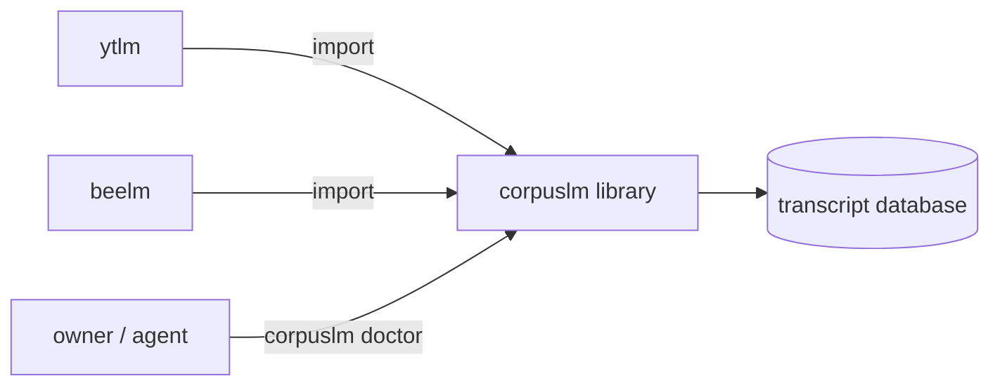

# Surfaces design

Status: DRAFT — not yet ratified by the owner.

Requirements: [../requirements/storage.md](../requirements/storage.md)

## A library first, with a small CLI (2026-10-03)

- corpuslm is a Python library; ytlm and beelm import it from an editable install of this repo (`pip install -e ../corpuslm`).
- The `corpuslm` command ([`src/corpuslm/cli.py`](../../src/corpuslm/cli.py)) has two verbs: `help`, and `doctor PATH`, which reads a database read-only and prints its schema version, journal mode, integrity check and table counts. `--json` anywhere prints the board as JSON. Nothing prints content.
- `setup` (creates the shared file, sets WAL) and the pointer check (each repo's `*_DB` resolves to the same file) come with the file-move step of nagarkar/ytlm#50.
- The repo skill is [`.claude/skills/corpuslm/SKILL.md`](../../.claude/skills/corpuslm/SKILL.md). No MCP server: no shell-less client needs corpuslm.

**Why:** metalm coding.md, "Surfaces": CLI always and first, a skill always, MCP only when needed. `doctor` is also the verification query the migration steps of #50 need (owner, 2026-10-03, grilling Q6).

**Rules out:** a library with no CLI recorded as an exception; an MCP server; a `doctor` that creates or upgrades a file.

## Changes

- 2026-10-03 Created (nagarkar/ytlm#50, slice 1).
